Использование RPC и RMI затруднено в условиях, когда нет уверенности, что принимающая сторона в момент передачи сообщения всегда будет работать. Альтернатива - очереди сообщений. Рассмотрим пример организации компьютерной сети:

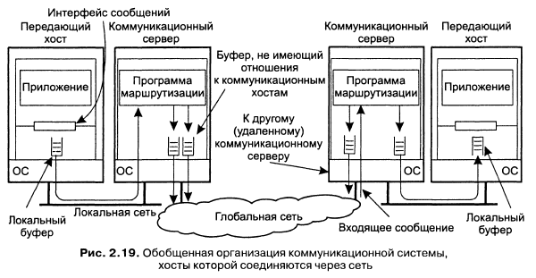

Приложения всегда выполняются на хостах, а каждый хост предоставляет интерфейс с коммуникационной системой, через которую передаются сообщения. Хосты соединены сетью коммуникационных серверов, которые отвечают за передачу сообщений между хостами. Буферы могут быть размещены как на хостах, так и на коммуникационных серверах.

**Сохранная связь**. При сохранной связи сообщение, предназначенное для отсылки, хранится в коммуникационной систему до тех пор, пока его не удастся передать получателю. Система сохранной связи сравнима по принципу работы с почтовой системой:

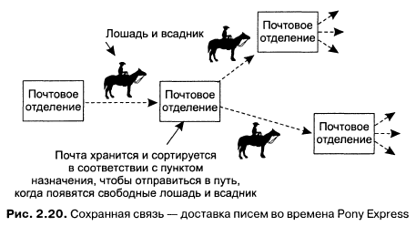

**Нерезидентная связь**. Сообщение хранится в системе только во время работы приложений, которые отправляют и принимают это сообщение. Коммуникационный сервер, не имея возможности передать сообщение следующему серверу, уничтожает его.

**Синхронная и асинхронная связь**. *Асинхронная связь* - немедленное после отправки сообщения продолжение работы отправителя. Сообщение сохраняется в локальном буфере передающего хоста или на ближайшем коммуникационном сервере. *Синхронная связь* - отправитель блокируется до того момента, пока его сообщение не будет сохранено в локальном буфере принимающего хоста или доставлено реальному получателю. Наиболее жёсткая форма синхронного взаимодействия предполагает, что отправитель остаётся блокированным и на время обработки его сообщения получателем.

Примеры комбинаций:
- Сохранная асинхронная - электронная почта
- Нерезидентная асинхронная - UDP и другие службы дейтаграмм транспортного уровня, асинхронный вызов RPC
- Нерезидентная синхронная связь- RPC и RMI

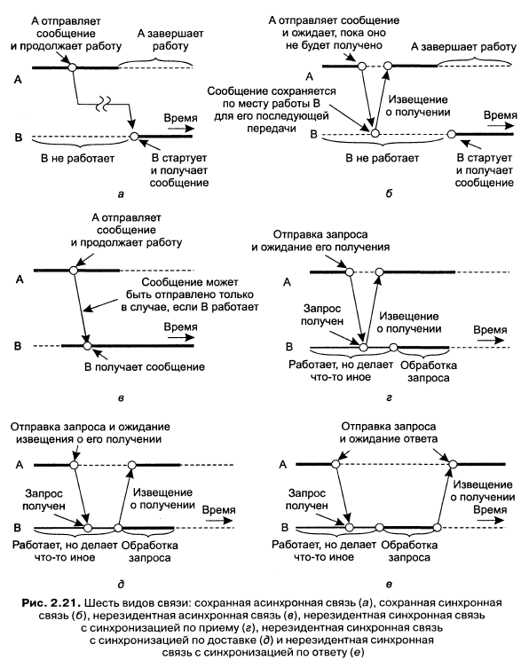

**Сокеты Беркли**. Это программный интерфейс транспортного уровня, использующийся в UNIX. *Сокет (socket)* - это конечная точка коммуникации. В эту точку приложение может записывать данные, которые стоит переслать по базовой сети, и из этой точки оно может читать исходящие данные.

Примитивы сокетов для TCP/IP:

Примитив | Назначение
--- | ---
Socket | Создать новую конечную точку коммуникации
Bind | Назначить сокету локальный адрес
Listen | Обозначить готовность к установке соединения
Accept | Заблокировать вызывающую сторону до прибытия запроса о соединении
Connect | Совершить попытку установить соединение
Send | Послать через соединение некоторые данные
Receive | Принять из соединения некоторые данные
Close | Разорвать соединение

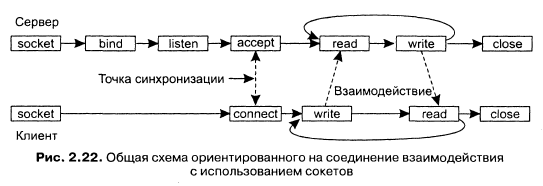

**Интерфейс передачи сообщений (MPI)**:

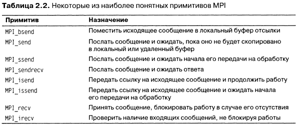

**Модель очереди сообщений**. Основная идея, лежащая в основе систем очередей сообщений, состоит в том, что приложения общаются между собой путём помещения сообщений в специальные очереди. Отправитель обычно в состоянии гарантировать только попадание сообщения - рано или поздно - в очередь получателя. Никакие гарантии относительно того, будет ли сообщение действительно прочитано, невозможны, это полностью определяется поведением получателя. Это определяет слабосвязанное взаимодействие. У получателя нет необходимости быть активным, когда сообщение пересылается в его очередь. Точно так же нет нужды в активности отправителя в момент обработки сообщения получателем. Отправитель и получатель могут выполняться абсолютно независимо друг от друга.

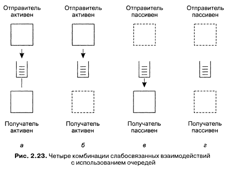

Базовый интерфейс, предоставляемый приложениям:

Примитив | Назначение
--- | ---
Put | Добавить сообщение в соответствующую очередь
Get | Приостановить работу до тех пор, пока в соответствующей очереди не появится сообщения, затем извлечь первое сообщение
Poll | Проверить наличие сообщений в соответствующей очереди, затем извлечь первое из них. Ничего не блокировать
Notify | Вставить дескриптор функции, которая будет вызвана при помещении сообщения в соответствующую очередь

**Общая архитектура системы очередей сообщений**. Сделаем ограничение, состоящее в том, что сообщение может быть помещено только в локальную очередь отправителя - в *исходящую очередь (source queue)*. Аналогично, прочитать сообщение можно только из локальной очереди - из *очереди назначения (destination queue)*. В обязанности системы очередей сообщений входит предоставление очередей отправителям и получателям и обеспечение перемещения сообщений из исходящий очередей в очереди назначения.

Набор очередей разнесён по множеству разных машин. Чтобы система очередей сообщений могла перемещать сообщения, она должна поддерживать отображение очередей на сетевые адреса. На практике это означает, что она должна поддерживать базу данных *имён очередей (queue names)*.

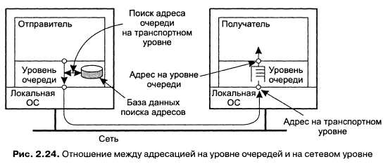

Во многих системах очередей сообщений не существует общих служб именования, которые могли бы динамически поддерживать отображение имён очередей на адреса. Тогда можно использовать несколько маршрутизаторов, имеющих информацию о топологии сети. Когда отправитель помещает в локальную очередь сообщение, это сообщение в сначала передаётся на ближайший маршрутизатор. При этом маршрутизатор знает, что делать с этим сообщением и передаёт его следующему маршрутизатору в направлении получателя. Таким образом, при добавлении или удалении очередей обновление информации потребуется только маршрутизаторам, в то время как остальным менеджерам очередей достаточно будет знать только местоположение ближайшего маршрутизатора.

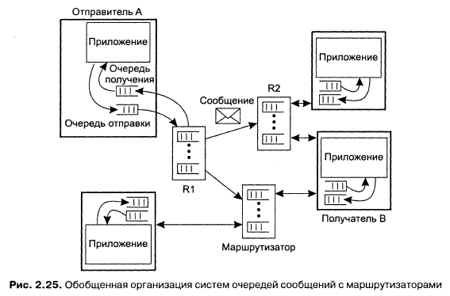

**Брокеры сообщений**. Каждый раз, когда в систему добавляется новый сервис, он привносит в неё свой специфический формат сообщений, и каждый потенциальный получатель должен научиться понимать этот формат. В системах очередей сообщений преобразование производится на специальных узлах сети - *брокерах сообщений (message brokers).* Основная задача брокеров сообщений - преобразование входящих сообщений в формат, который понимается целевым приложением.

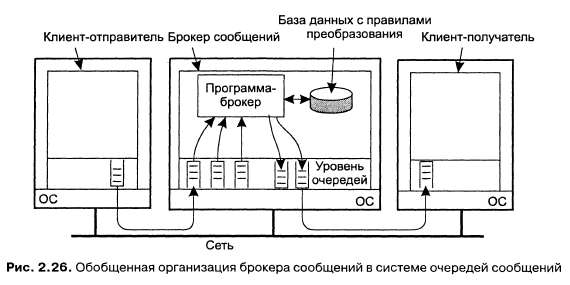

**IBM MQSeries**.

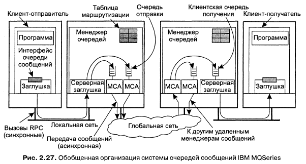

*Канал сообщений* - это ненаправленное надёжное соединение между отправляющим и принимающим менеджерами очередей, по которому передаются находящиеся в очереди сообщения.

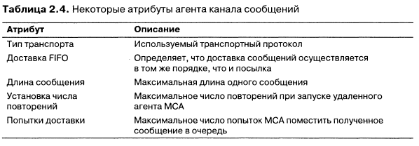

Организация сети:

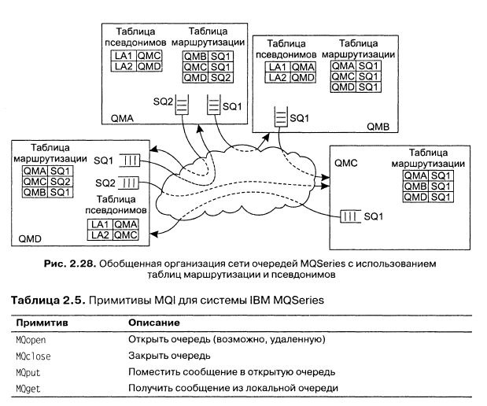

Известные протоколы:
- JMS (Java Message API)
- AMQP (Advanced Message Queuing Protocol)
- MQTT (Message Queuing Telemetry Transport)
- STOMP (Streaming Text Oriented Messaging Protocol)

Известные реализации:
- Windows Message Queues
- Apache Kafka
- RabbitMQ
- ZeroMQ
- ActiveMQ
- ESB (Enterprise Service Bus)
- Apache Camel