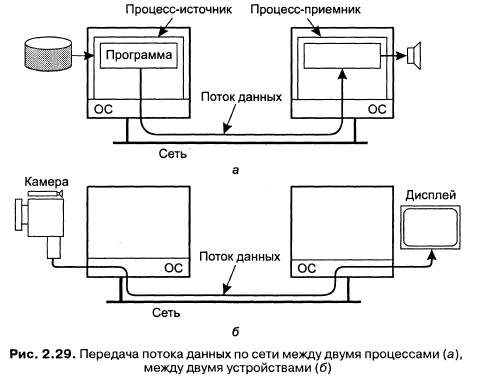
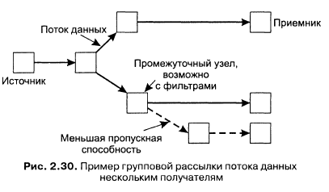
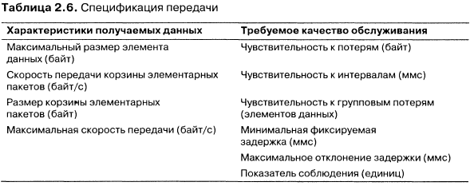
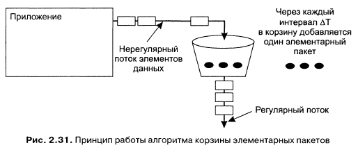
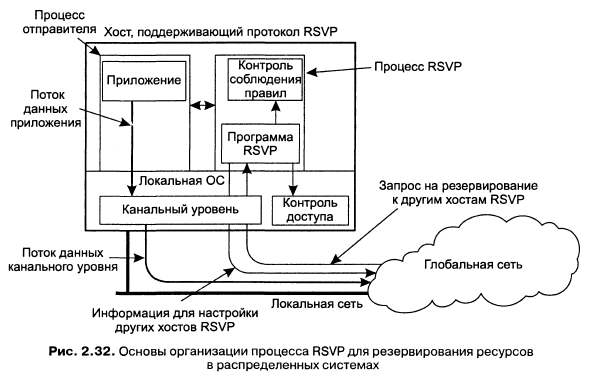
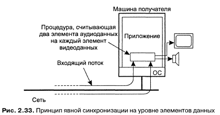
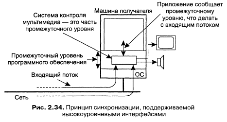

*Среда передачи* - то, что несёт информацию. Важнейшая характеристика среды - способ представления информации, как информация кодируется в компьютерной системе.

В *непрерывной среде представления (continuous representation media)* временные соотношения между различными элементами данных лежат в основе конкретной интерпретации смысла данных (аудио, видео).

**Поток данных**. Это последовательность элементов данных.

Режимы передачи:
- Асинхронный - элементы данных передаются в поток один за другим, но на их дальнейшую передачу никаких ограничений в части временных характеристик не вводится
- Синхронный - для каждого элемента в потоке данных определяется максимальная задержка сквозной передачи
- Изохронны - все элементы должны передаваться вовремя (для передачи элемента данных существуют одновременно максимальная задержка и минимальная задержка)

Поток данных можно рассматривать как виртуальное соединение между источником и приёмником. Источник или приёмник может быть процессом или устройством.

Есть возможность организовать многостороннюю связь. Наиболее частая ситуация - присоединение к потоку данных нескольких приёмников (групповая рассылка). Проблемой групповой рассылки являются разные требования разных приёмников к качеству потока. Можно настроить поток на фильтрацию, которая приводит в соответствие качество входящего потока и отличное от него качество исходящего:

**Качество обслуживания (Quality of Service, QoS)**. Это требования, описывающие, что должны сделать базовая РС и сеть для того, чтобы гарантировать сохранение в потоке данных временных соотношений (и не только).

*Алгоритм корзины элементарных пакетов* - алгоритм для формирования сетевого трафика. Есть корзина, которая заполняется условными элементарными пакетами с постоянной скоростью. Элементарный пакет представляет фиксированное число байтов, которое приложение намерено передать по сети. Ёмкость корзины ограничена, после переполнения новые пакеты просто пропадают. Каждый раз, когда приложение хочет отправить в сеть N байтов данных, оно должно извлечь из корзины столько элементарных пакетов, чтобы их суммарный размер был больше N.

**Протокол резервирования ресурсов (Resource reSerVation Protocol, RSVP)**. Это управляющий протокол транспортного уровня для резервирования ресурсов сетевых маршрутизаторов.

Передатчики в RSVP предоставляют спецификацию передачи, характеризующую поток данных. Это описание передаётся процессу RSVP, который работает на той же машине, что и отправитель. Фактически единственное, что он делает - это принимает спецификацию передачи от отправителя и локально сохраняет её. RSVP - это инициируемый получателем протокол QoS. Получатель должен запросить у отправителя запрос на резервирование.

Отправитель в RPSV определяет путь к потенциальным получателям и предоставляет спецификацию передачи для потока данных всем промежуточным узлам. Когда получатель готов принимать входящие элементы данных, он сначала посылает запрос на резервирование по обратному маршруту своему отправителю.

**Синхронизация потоков данных**. Механизмы синхронизации могут располагаться на разных уровнях абстракций. На самом нижнем уровне, синхронизация синхронизация полностью определяется работой с элементами данных простых потоков. Например, с помощью процесса, который осуществляет операции чтения и записи в нескольких простых потоках данных, гарантирую при этом соблюдение ограничений синхронизации.

В действительности системы мультимедиа промежуточного уровня содержат набор интерфейсов для управления аудио- и видеопотоками, включаю интерфейсы управляющих устройств (камеры, мониторы, микрофоны, динамики и т. д.). Каждое устройство и поток данных имеют свои собственные интерфейсы верхнего уровня , в том числе и интерфейсы для уведомления приложений о наступлении некоторого события. Эти интерфейсы часто используются для написания обработчиков, предназначенных для синхронизации потоков.

