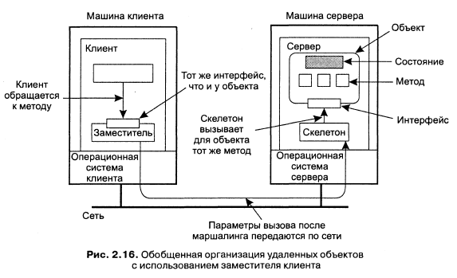
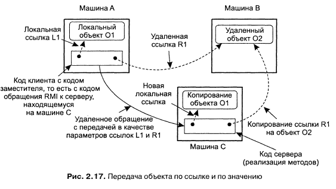
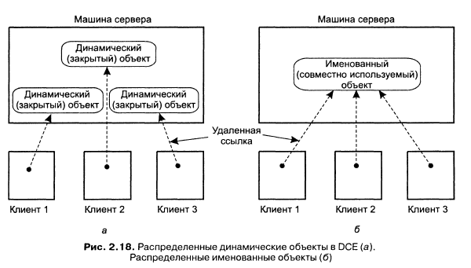

Объект инкапсулирует данные (состояние) и операции над ними (методы). Доступ к методам можно получить через интерфейс. Объект может реализовывать множество интерфейсов, а интерфейс может быть реализован множеством объектов. Такое разделение на интерфейсы и объекты позволяет помещать интерфейс на одну машину, в то время как сам объект находится на другой. Это называется *распределённый объект*.

Когда клиент выполняет привязку к распределённому объекту, в адресное пространство клиента загружается реализация интерфейса объекта, называемая *заместителем (proxy)*. Заместитель клиента аналогичен клиентской заглушке в RPC. Единственное, что он делает - выполняет маршалинг параметров в сообщениях при обращении к методам и демаршалинг данных из ответных сообщений. Сами объекты находятся на сервере и предоставляют клиентской машине необходимые интерфейсы. Входящий на сервер запрос на выполнение метода сначала попадает на серверную заглушку, которая называется *скелетон (skeleton)*. Скелетон преобразует его в обращение к методу через интерфейс объекта на сервере. Серверная заглушка затем выполняет маршалинг ответа и пересылку его заместителю клиента.

Состояние объекта не распределяется - оно локализовано на одной машине.

**Передача параметров**. Если все объекты распределённые, то они доступны со всех машин в системе. В этом случае при обращении к методу можно использовать ссылки на объекты как параметры. Ссылки передаются по значению и копируются с одной машины на другую. Если ссылка относится к локальному объекту, то есть к объекту в адресном пространстве клиента, то объект, на который указывает ссылка, целиком копируется и в процессе обращения передаётся серверу. Другими словами, объект передаётся по значению.

**Модель распределённых объектов DCE**. Поддерживается два типа распределённых объектов. *Динамические распределённые объекты (distributed dynamic objects)* - это объекты, которые создаются сервером локально по требованию клиента и к которым в принципе имеет доступ один клиент. *Именованные распределённые объекты (distributed named objects)* создаются сервером для совместного использования несколькими клиентами. Именованные объекты регистрируются службой каталогов, так что клиент может найти объект и выполнить привязку к нему.

