**OSI**:

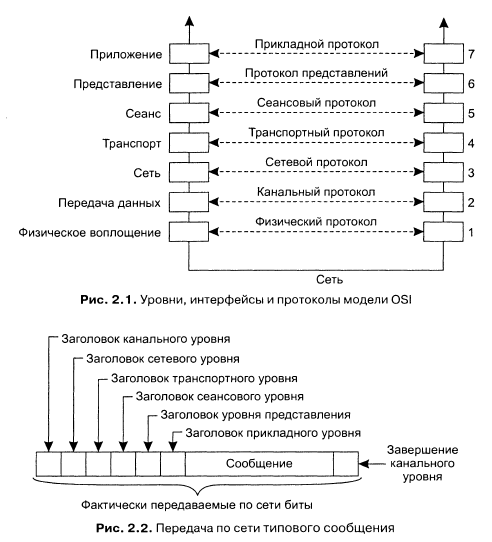

**Пример протокола канального уровня**:

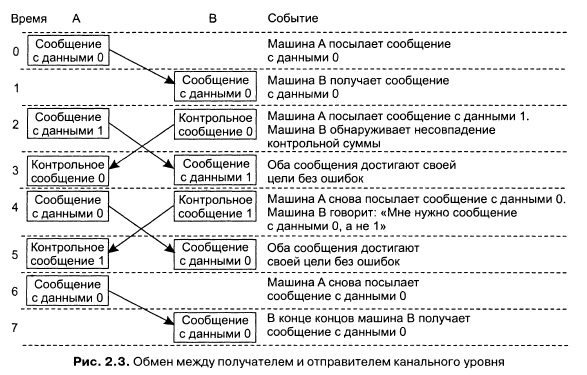

**TCP и T/TCP**:

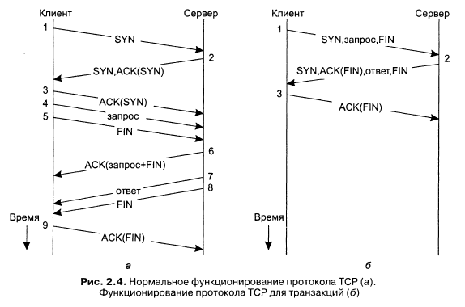

**Протоколы промежуточного уровня**. К промежуточному уровню относятся протоколы, логически помещаемые прикладной уровень, но содержащие множество протоколов общего назначения. Можно отделить отделить высокоуровневые протоколы взаимодействия от протоколов для предоставления различных служб промежуточного уровня. Примеры: аутентификация, блокировка общих ресурсов, распределённые транзакции.

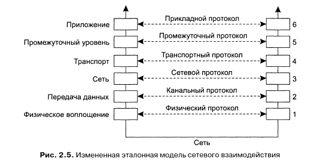

**RPC**. Программам позволяется вызывать процедуры, находящиеся на других машинах. Когда процесс, запущенный на машине A, вызывает процедуру с машины B, вызывающий процесс на машине A приостанавливается, а выполнение вызванной процедуры происходит на машине B. Информация может быть передана от вызывающего процесса к вызываемой процедуре через параметры и возвращена процессу в виде результата выполнения процедуры. Для программиста всё прозрачно - как будто код выполнялся локально.

**Заглушки для клиента и сервера.** В клиенте используется специальная версия функции, называемая клиентской заглушкой. Её вызов происходит точно также, как и вызов любой другой функции. Она упаковывает переданные параметры в сообщение и отправляет на сервер и блокируется до получения ответа. Когда сообщение приходит на сервер, ОС сервера передаёт его серверной заглушке, которая преобразует входящие по сети запросы в вызовы процедур. После получения запроса серверная заглушка распаковывает его, извлекая параметры, и передаёт их в процедуру сервиса. Далее серверная заглушка упаковывает результат вызова в сообщение и отсылает его клиенту.

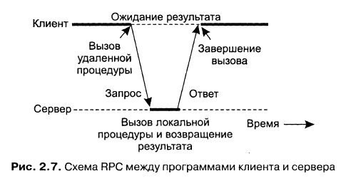

При удалённом вызове процедур происходят следующие действия:
1. Процедура клиента обычным образом вызывает клиентскую заглушку
2. Клиентская заглушка создаёт сообщение и вызывает локальную ОС
3. ОС клиента пересылает сообщение удалённой ОС
4. Удалённая ОС передаёт сообщение серверной заглушке
5. Серверная заглушка извлекает из сообщения параметры и вызывает сервер
6. Сервер выполняет вызов и возвращает результаты серверной заглушке
7. Серверная заглушка запаковывает результаты в сообщение и вызывает свою локальную ОС
8. ОС сервера пересылает сообщение ОС клиента
9. ОС клиента принимает сообщение и передаёт его клиентской заглушке
10. Клиентская заглушка извлекает результаты из сообщения и передаёт их клиенту

**Передача параметров.** Упаковка параметров в сообщение носит название маршалинга параметров. Также вместе с параметрами посылается имя вызываемой процедуры:

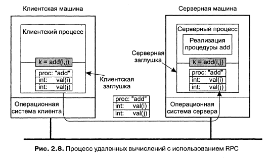

До тех пор пока машины клиента и сервера идентичны, а все параметры и результаты имеют скалярный тип, эта модель работает абсолютно правильно. Однако в больших РС обычно присутствуют машины разных типов. Каждая может иметь разное представление чисел (big endian и little endian), символов (кодовые таблицы) и других элементов данных:

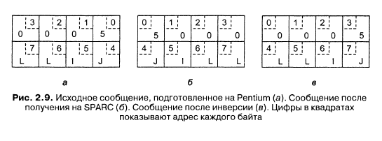

Поэтому клиент и сервер должны следовать одному протоколу с одинаковым представлением типов данных.

**Пример определения формата сообщения**:

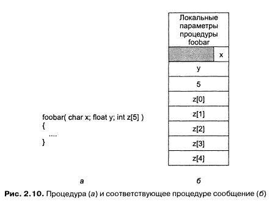

**IDL.** Заглушки, работающие по одному протоколу для разных, процедур различаются лишь интерфейсом с приложениями. Интерфейс состоит из набора процедур, которые могут быть вызваны клиентом, но реализуются на сервере. Доступ к интерфейсу осуществляется обычно из определённого языка программирования. Для упрощения работы интерфейса часто описываются с использованием языка определения интерфейсов (Interface Definition Language, IDL). Интерфейс, определённый таким образом, компилируются затем в заглушки клиента и сервера, а также в соответствующие интерфейсы времени компиляции и времени выполнения.

**Облегчённый механизм RPC**. Когда клиент и сервер установлены на одной машине мы должны использовать средства локального межпроцессорного взаимодействия (InterPorcess Comunication, IPC).

Некоторые ОС предоставляют процессам, размещённым на одной машине, эквивалент RPC под названием входы (doors). Вход - это обобщённое имя процедур, существующих в адресном пространстве процессов сервера, которые могут вызываться процессами, размещенными на одной с сервером машине. Для того, чтобы появилась возможность вызвать вход, процесс сервера должен зарегистрировать его. При регистрации возвращается идентификатор, который потом клиент может использовать для доступа к входу.

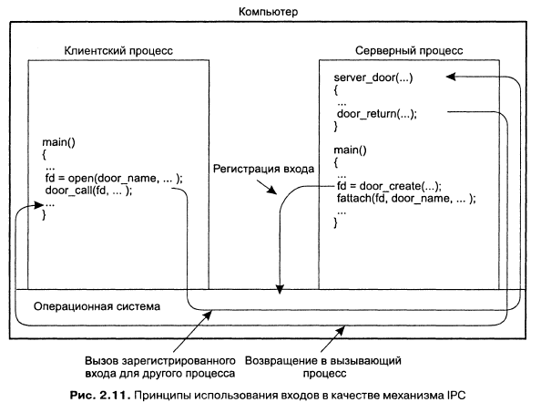

**Асинхронный вызов RPC**. Клиент получает возможность продолжить свою работу сразу после выполнения запроса RPC. При асинхронном вызове RPC сервер немедленно по приходу запроса отсылает клиенту ответ, после чего вызывает запрошенную процедуру. Ответ служит подтверждением того, что сервер приступил к обработке запроса.

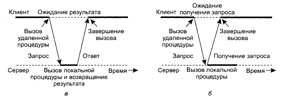

Асинхронные вызовы RPC также полезны в тех случаях, когда ответ будет послан, но клиент не готов просто ждать его, ничего не делая. В подобных случаях имеет смысл организовать сообщение между клиентом и сервером через два асинхронных вызова RPC. Сначала клиент вызывает сервер, чтобы передать запрос, и продолжает свою работу, когда сервер подтверждает получение. Второй вызов делает сервер, который вызывает клиента, чтобы передать результат. Это также называется *отложенным синхронным вызовом RPC (deffered synchronous RPC*).

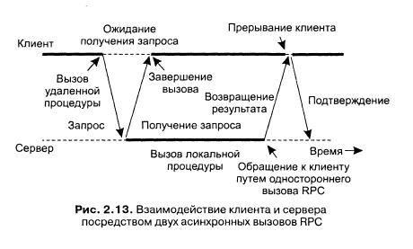

**Написание клиента и сервера**:

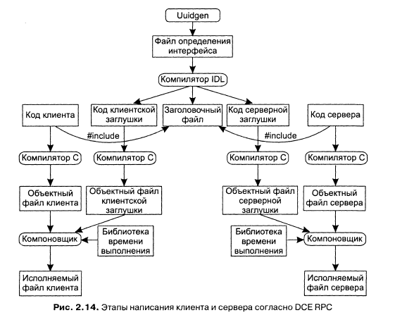

**Привязка клиента к серверу**. Чтобы позволить клиенту вызывать сервер, необходимо, чтобы сервер был зарегистрирован и готов к приёму входящих вызовов. Регистрация сервере даёт клиенту возможность реально обнаружить сервер и выполнить привязку к нему. Обнаружение сервера происходит в два этапа:
1. Обнаружение машины сервера
2. Обнаружение нужного процесса на этой машине (конечная точка или порт)

В DCE (Distributed Computing Environment) на каждой из серверных машин процессом DCE-демон поддерживается таблица пар сервер - конечная точка. Перед тем как сервер станет доступным для входящих запросов, он должен запросить у ОС конечную точку. Далее сервер регистрирует эту конечную точку у DCE-демона. DCT-демон записывает эту информацию в таблицу конечных точек. Сервер также регистрирует предоставленные серверной машине сетевой адрес и имя, под которым сервер будет доступен.

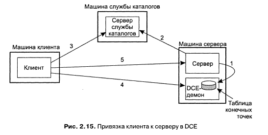

Привязка выполняется в несколько этапов:
1. Регистрация конечной точки
2. Регистрация службы
3. Поиск сервера службы каталогов
4. Запрос конечной точки
5. Выполнение вызова RPC