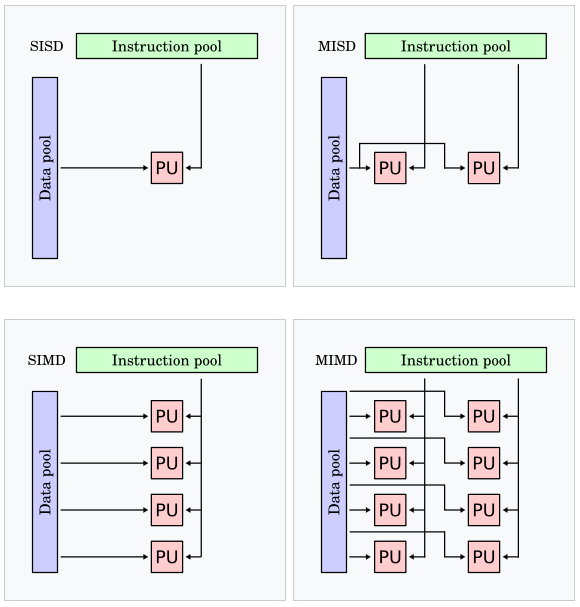
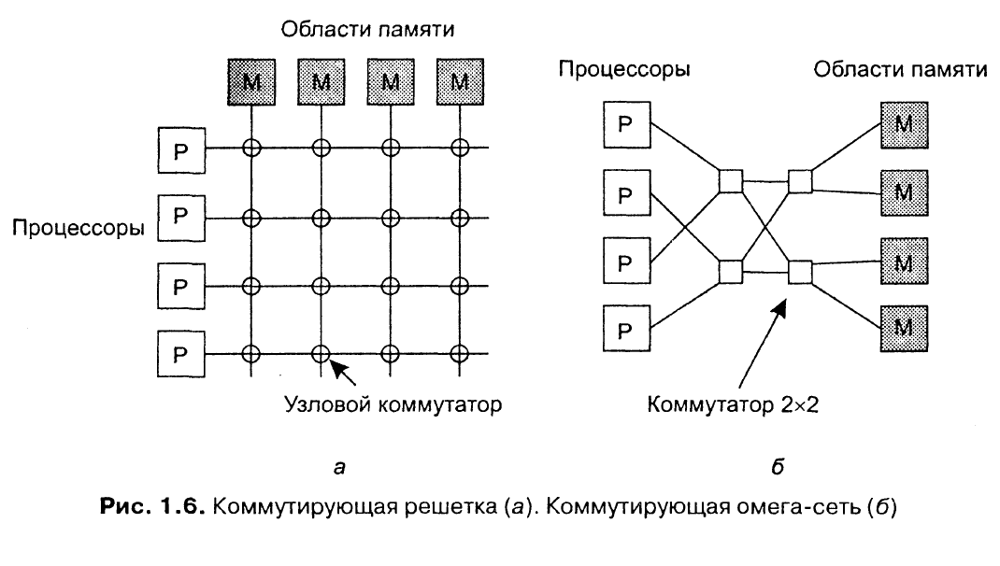
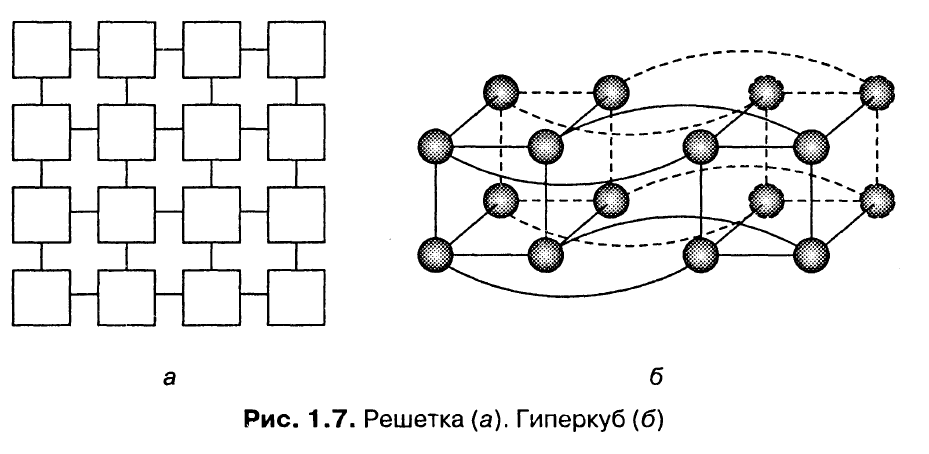

**Таксономия Флинна:**
- SISD (single instruction stream, single data stream) - традиционный компьютер фон-Неймановской архитектуры с одним процессором, который выполняет одну инструкцию за другой, работая с одним потоком данных
- SIMD (single instruction stream, multiple data stream) - один процессор загружает одну инструкцию, набор данных для неё, и выполняет операцию над всем набором данных одновременно. Параллельные суперкомпьютеры
- MISD (multiple instruction stream, single data stream) - несколько инструкций оперируют над одним потоком данных. Почти не используется
- MIMD (multiple instuction stream, multiple data stream) - несколько автономных процессоров одновременно выполняют разные инструкции на разных наборах данных. Все распределённые системы



Классификация компьютерных систем с несколькими процессорами:
- Мультипроцессорные - процессоры (компьютеры) используют память совместно, имеют единое адресное пространство
- Мультикомпьютерные - каждый работает со своей памятью

Каждая из этих категорий может быть подразделена на дополнительные категории на основе архитектуры соединяющей их сети:
- Шинная - есть общая среда (шина, кабель, плата), через которую несколько процессоров подключаются к общей памяти
- Коммутируемая - машины связаны каналами, через которые передаются все сообщения. Для передачи каждого сообщения происходит коммутация через специальные устройства

Мультикомпьютерные системы делятся на:
- Гомогенные - одна соединяющая компьютерная сеть, использующая единую технологию. Также одинаковы все процессоры, которые в основном имеют доступ к одинаковым объёмам собственной памяти
- Гетерогенные - множество различных независимых компьютеров, соединённых разнообразными сетями

**Мультипроцессоры.** При большом количестве процессоров, обращающихся к общей памяти, шина может быть перегружена. Решением проблемы является размещение между процессором и шиной высокоскоростной кэш-памяти. При этом возникает проблема несогласованности памяти, что усложняет программирование системы.

При большом количестве процессоров даже при использовании кэша возникает проблема производительности (системы с более чем 256 процессорами). Один из вариантов - разделить общую память на модули и связать их с процессорами через коммутирующую решётку.



Каждое пересечение это узловой коммутатор, который открывается аппаратно, когда процессор пытается получить доступ к модулю памяти. Если два процессора одновременно хотят получить доступ к одному модулю памяти, то одному из них придётся ждать. Если у нас n процессоров и n модулей памяти, то понадобится n<sup>2</sup> узловых коммутаторов, при больших n это может превышать доступные ресурсы. В таких случаях используют омега-сеть. В ней каждый коммутатор может соединять любой вход с любым выходом.
**Гомогенные мультикомпьютерные системы.** В коммутируемых мультикомпьютерных системах сообщения, передаваемые от процессора к процессору, маршрутизируются в соединительной сети. Есть разные топологии их соединения:



Каждая вершина - это процессор, каждое ребро - связь между двумя процессорами.
```
При наличии тысяч процессоров каждую неделю как минимум несколько
будут выходить из строя. Нельзя допустить, чтобы поломка одного из
них приводила к выводу из строя всей машины.
```
**Гетерогенные мультикомпьютерные системы:**
- Размер памяти, тип процессора, быстродействие не важны
- Связь через локальные сети или интернет