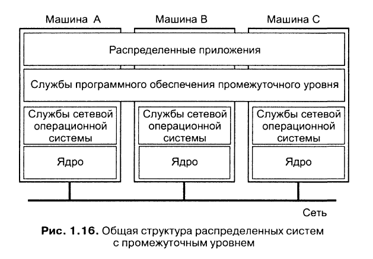
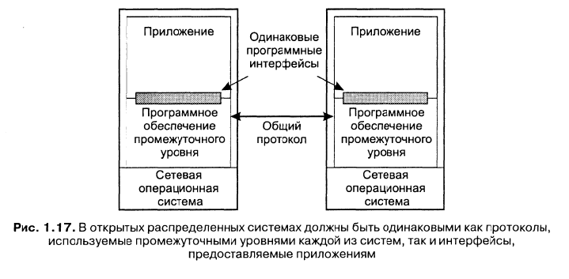

Ни DOS, ни NOS не позволяют создавать РС, одновременно удовлетворяющие требованиям атомарности узлов и согласованности их работы. DOS не предназначены для управления набором независимых компьютеров, а NOS не дают представления одной согласованной системы. Для решения этой проблемы используется ПО промежуточного уровня (middleware).

**Позиционирование ПО промежуточного уровня**. ПО промежуточного уровня используется в сетевых операционных системах для того, чтобы скрыть разнородность набора аппаратных платформ и повысить прозрачность распределения. Оно находится посередине между уровнем приложений и уровнем сетевой ОС:

Каждая локальная система, составляющая часть сетевой ОС, отвечает за управление локальными ресурсами и предоставляет базовые коммуникационные средства для связи с другими компьютерами. Основная задача ПО промежуточного уровня - скрыть разнообразие базовых платформ от приложений.

**Модели промежуточного уровня:**
- Распределённая файловая система
- Механизм вызова удалённых процедур (RPC)
- Модель распределённых объектов
- Модель распределённых документов (WWW)
- Микросервисная архитектура

**Сервисы промежуточного уровня:**
- Высокоуровневые средства связи
- Сервис именования
- Средства хранения данных
- Распределённые транзакции
- Средства обеспечения защиты
- Средства виртуализации и контейнеризации

**Промежуточный уровень и открытость.** Современные РС создаются в виде систем промежуточного уровня для нескольких платформ. При этом приложения создаются для конкретной РС и не зависят от платформы (т. е. от ОС). Однако неполнота описания интерфейса ПО промежуточного уровня может привести к следующим проблемам:
- Разработчики вынуждены добавлять свои собственные интерфейсы. Тогда может возникнуть ситуация, в которой в соответствии с одним и тем же стандартом создаются разные системы промежуточного уровня, и приложения, написанные под одну из систем, не могут быть перенесены на другую
- Две реализации ПО промежуточного уровня могут быть основаны на одинаковом наборе интерфейсов, но использовать разные коммуникационные протоколы

Необходимо, чтобы и протоколы промежуточного уровня, и его интерфейсы были одинаковы:

**Сравнение между системами:**

Характеристика | Мультипроц. РС | Мультикомп. РС | Сетевая ОС | РС промеж. уровня
--- | --- | --- | --- | ---
Степень прозрачности | Очень высокая | Высокая | Низкая | Высокая
Идентичность ОС на всех узлах | Поддерж. | Поддерж. | Не поддерж. | Не поддерж.
Число копий ОС | 1 | N | N | N
Коммуникация на основе | Совместно исп. памяти | Сообщений | Файлов | Зависит от модели
Управление ресурсами | Глобальное, централизованное | Глобальное, распределённое | Отдельно на узле | Отдельно на узле
Масштабируемость | Отсутствует | Умеренная | Да | Различная
Открытость | Закрытая | Закрытая | Открытая | Открытая