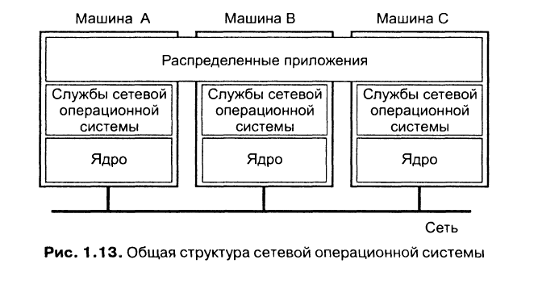
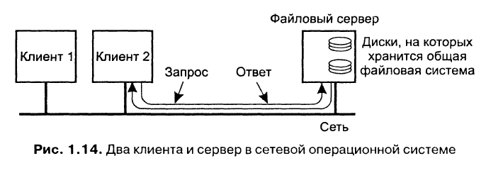

Сетевые ОС не нуждаются в том, чтобы аппаратное обеспечение, на котором они функционируют, было гомогенно и управлялось как единая система. Машины и их ОС могут быть разными, но все они соединены в сеть. Сетевая ОС позволяет пользователям использовать сервисы, расположенные на конкретной машине.

Сервисы: удалённое подключение, копирование файлов, глобальная общая файловая система.

**Глобальная общая файловая система.** Файловая система поддерживается одной или несколькими машинами, которые называются файловыми серверами. Файловые серверы принимают запросы от клиентов на чтение и запись:

Рабочие станции могут импортировать или монтировать эти файловые системы, увеличивая свою локальную ФС за счёт ФС сервера.
- Разные клиенты монтируют ФС по-разному
- Разные клиенты могут иметь разное представление ФС (различное именование файлов, организация доступа и т. д.). Поскольку каждая клиентская машина работает относительно независимо от других, невозможно дать какие-то гарантии, что они обладают одинаковой иерархией каталогов для своих программ. Отсюда получается **Неполная прозрачность**