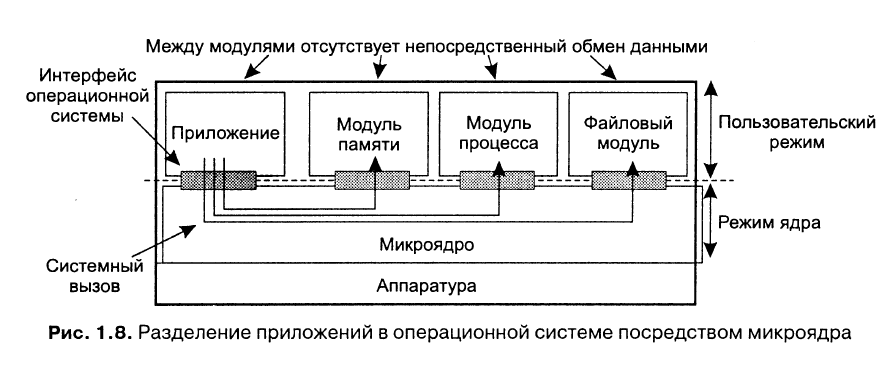
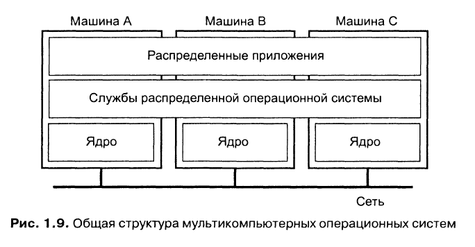
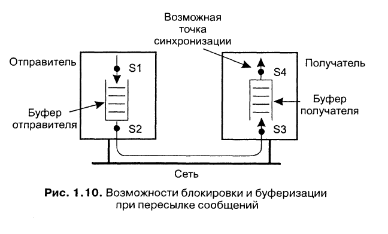
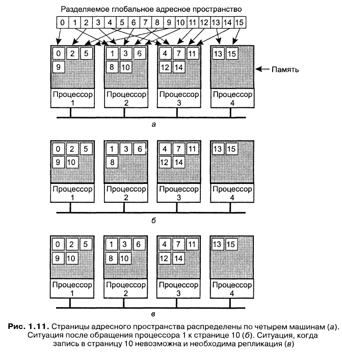
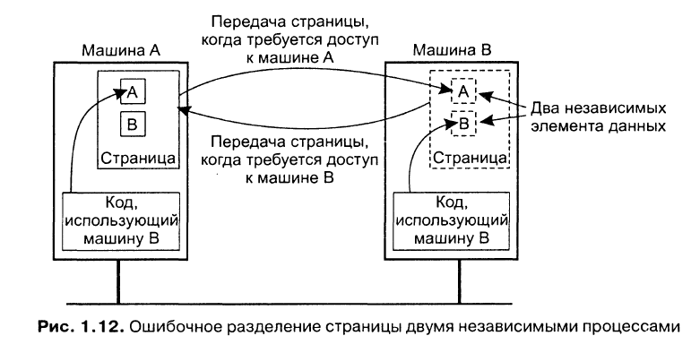

Операционные системы для РС можно разделить на две категории: распределённые ОС (Distributed Operating System, DOS) и сетевые ОС (Network Operating System, NOS). Для поддержки прозрачности распределения к NOS добавляют системы промежуточного уровня (middleware).

Система | Описание | Основное назначение
--- | --- | ---
DOS | Сильно связанные ОС для мультипроцессоров и гомогенных мультикомпьютерных сетей | Сокрытие и управление аппаратным обеспечением
NOS | Слабо связанные ОС для гетерогенных мультикомпьютерных систем (локальных или глобальных систем) | Предоставление локальных служб удалённым клиентам
Middleware | Дополнительный уровень поверх сетевых ОС, реализующий службы общего назначения | Обеспечение прозрачности распределения

**ОС для однопроцессорных компьютеров.** Основная задача - организация лёгкого доступа пользователей и приложений к разделяемым устройствам (процессор, память, диски, периферийные устройства и т. д.). ОС должна полностью контролировать использование и распределение аппаратных ресурсов, поэтому процессоры поддерживают два режима работы: режим ядра (все разрешённые инструкции, доступна вся память и любые регистры) и пользовательский режим (доступ к регистрам и памяти ограничен).

Микроядро - ОС организуется в виде двух частей. Одна часть содержит набор модулей управления аппаратные обеспечением, которые могут выполняться в пользовательском режиме:
```
Например, управление памятью состоит в основном из отслеживания, какие блоки памяти выделены под процессы, а какие свободны
```
Вторая часть ОС содержит небольшое микроядро, содержащее код, выполняющийся исключительно в режиме ядра. Тогда доступ между модулями разграничивается через микроядро:



**Мультипроцессорные ОС.** Несколько процессоров имеют доступ к совместно используемой памяти. Необходимо использовать примитивы синхронизации.

Семафор - целое число и две атомарные операции: up, down. При уменьшении проверяется, превышает ли значение семафора 0. Если это так, значение уменьшается и выполнение продолжается. В противном случае поток блокируется. При увеличении запускается один из заблокированных потоков. Если таких нет, счётчик увеличивается.

Монитор - модуль, содержащий переменные и процедуры. Доступ к переменным только через процедуры, в один момент времени процедуру может выполнять только один поток.
- Используем мониторы для синхронизации доступа
- Более структурированный код по сравнению с семафорами

``` java
monitor Counter {
private:
    int count = 0:
public:
    int value() { return count; }
    void incr() { count = count + 1;}
    void decr() { count = count - 1;}
}
```
Условные переменные - wait и signal.
- Монитор с условием
- wait(x) - предоставляет монитор другим процессам и ожидает события signal(x)

Реализация семафора:
```java
monitor Counter {
private:
    int count = 0;
    int blockecl_procs = 0;
    condition unblocked:
public:
    int value() { return count:}

    void incr() {
        if (blockecl_procs == 0) {
            count = count + 1;
        } else {
            signal( unblocked );
        }
    }

    void decr() {
        if (count == 0) {
            blocked_procs = blocked_procs + 1;
            wait( unblocked ):
            blocked_procs = blocked_procs - 1;
        } else {
            count = count - 1:
        }
    }
}
```
**Мультикомпьютерные ОС.** Каждый узел имеет своё ядро, которое содержит модули для управления локальными ресурсами. Отсутствие общей разделяемой памяти.



Поверх каждого локального ядра лежит уровень ПО общего назначения, реализующий ОС в виде машины, поддерживающей параллельную работу над различными задачами.

Буферизация и синхронизация при отправке сообщений:



Точка синхронизации | Буферизация отправителя | Гарантия надёжной связи
--- | --- | ---
 Блокировка отправителя до наличия свободного места в буфере | Да | Нет необходимости
 Блокировка отправителя до посылки сообщения | Нет | Нет необходимости
 Блокировка отправителя до приёма сообщения | Нет | Необходима
 Блокировка отправителя до обработки сообщения | Нет | Необходима

**Системы с распределённой разделяемой памятью.** Адресное пространство разделено на страницы, распределённые по всем процессорам системы. Когда процессор адресуется к памяти, которая не является локальной, происходит внутреннее прерывание, ОС считывает в локальную память страницу, содержащую указанный адрес, и перезапускает выполнение вызвавшей прерывание инструкции.



Если страница содержит данные двух независимых процессов, выполняющихся на разных процессорах, ОС будет вынуждена постоянно пересылать эту страницу от одного процессора к другому:

