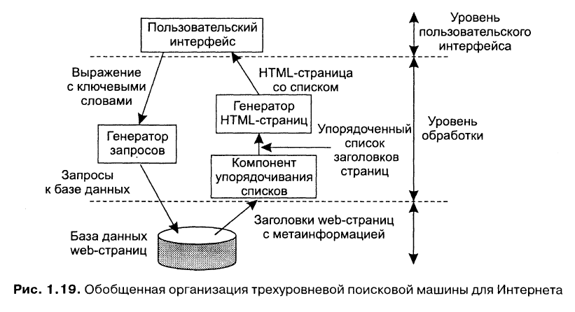
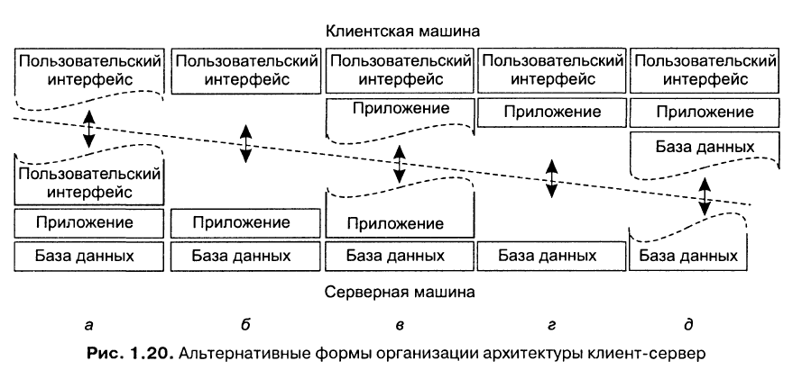
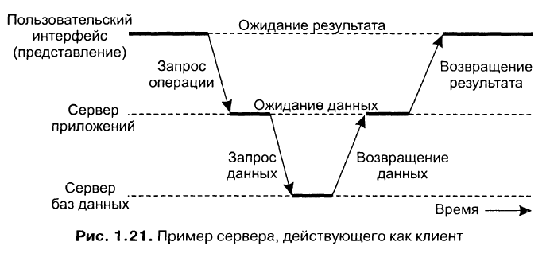
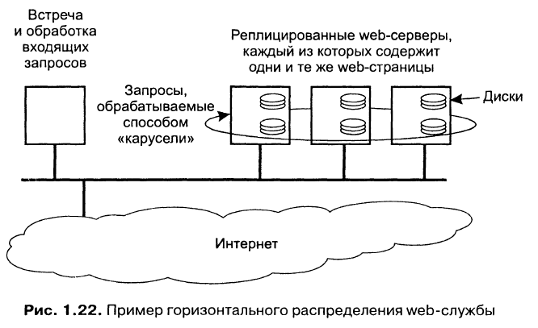

Три уровня обработки:
- Уровень пользовательского интерфейса - всё необходимое для непосредственного общения с пользователем
- Уровень обработки - содержит приложения
- Уровень данных - содержит данные, с которыми происходит работа

**Пример работы поисковой системы.** Пользовательский интерфейс прост: пользователь вводит строку, состоящую из ключевых строк, и получает список заголовков web-страниц. Результат формируется из БД просмотренных и проиндексированных web-страниц. Уровнем обработки является программа, трансформирующая введённую пользователем строку в один или несколько запросов к БД. Затем результаты отдаются в виде HTML-страницы.

**Физически двухзвенная архитектура.** Один из вариантов организации работы клиентов и серверов - распределение программ уровня приложений по различным машинам. Первый шаг - разделение машин на два типа: клиенты и серверы. Причём ответственность может распределяться по-разному:

**Физически трёхзвенная архитектура.** Серверу иногда может понадобиться работать в качестве клиента, это приводит к физически трёхзвенной архитектуре. Программы, составляющие часть уровня обработки выносятся на отдельный сервер. Типичный пример - обработка транзакций. В этом случае отдельный процесс - монитор транзакций - координирует все транзакции, возможно на нескольких серверах данных.

**Современные архитектуры.** Описанное выше распределение называется *вертикальным*. Оно достигается размещением логически различных компонентов на разных машинах. В современных архитектурах распределение на клиентов и серверы происходит способом, известным, как *горизонтальное распределение*. В нём клиент или сервер может содержать физически разделённые части логически однородного модуля, причём работа с каждой из частей может происходить независимо. Это делается для выравнивания нагрузки. ~~речь про микросервисы?~~

Распространённый пример - web-сервер, реплицированный на несколько машин.

