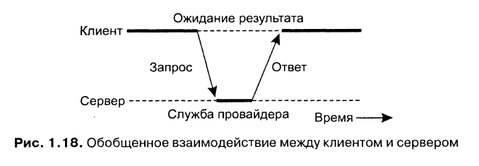

В модели клиент-сервер все процессы делятся на две группы:
- Серверы - процессы, реализующие некоторую службу
- Клиенты - процессы, которые запрашивают службу у серверов

Взаимодействие клиента и сервера происходит в режиме запрос-ответ:

